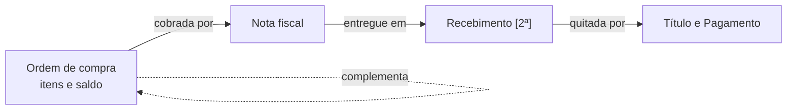
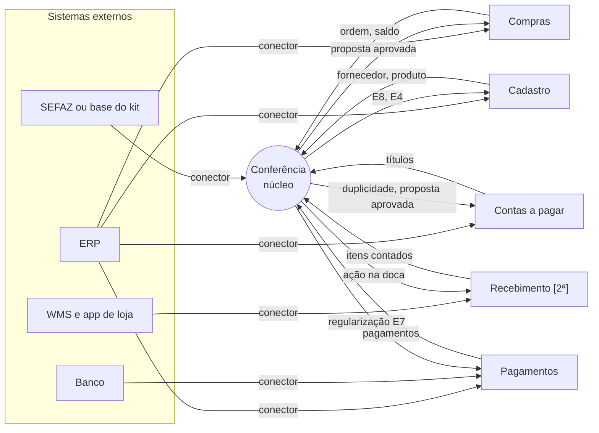
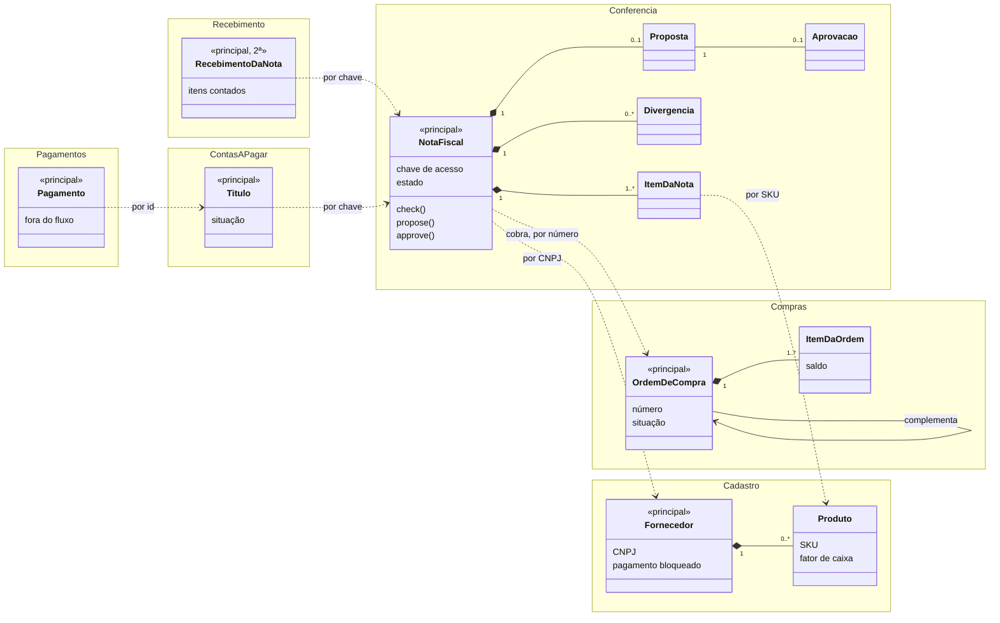
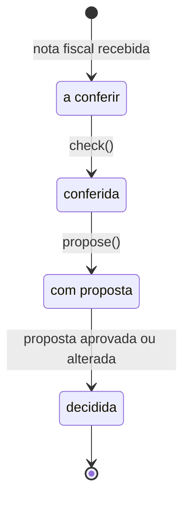
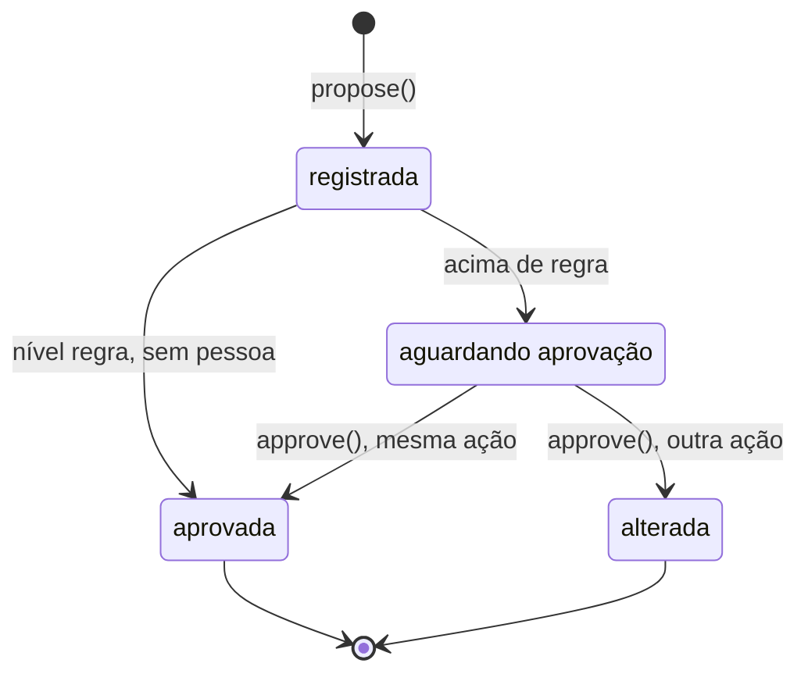

# Modelo de domínio do contas a pagar da Já Chegou

**[1ª]** e **[2ª]** marcam em que entrega cada parte entra: **[1ª]**, a conferência da nota contra a ordem de compra, antes da doca; **[2ª]**, a conferência da nota contra o que foi recebido.

**A pergunta que o modelo responde:** esta nota fiscal cobra uma compra que existe, ainda não foi
paga e chegou como foi pedida?

## A corrente da compra

Cada exceção é uma ligação quebrada:

| Ligação quebrada | Exceções | Entrega |
|---|---|---|
| A nota não cobra nenhuma ordem | E5 nota sem ordem | [1ª] |
| A nota cobra itens diferentes da ordem | E2 item trocado, E4 unidade de medida, E8 item sem cadastro | [1ª] |
| A compra já foi cobrada ou paga | E6 duplicidade, E7 pago fora do fluxo | [1ª] |
| O recebido não bate com a nota | E1 falta física, E3 quantidade menor | [2ª] |

## Mapa de contextos

Conector: um por sistema; leva os dados do sistema para as entidades do contexto.

| Contexto | Tipo | Dono na Já Chegou | Publica para a Conferência | Consome da Conferência | Relação com a Conferência |
|---|---|---|---|---|---|
| **Conferência** | Núcleo | Contas a pagar, com o agente | — | — | — |
| **Compras** | Suporte | Gerente de compras | Ordem de compra, itens, saldo, situação | Proposta aprovada: quanto a nota cobrou da ordem; divergência que pede ordem complementar | Cliente e fornecedor: a Conferência é cliente |
| **Cadastro** | Genérico | Gerente de compras | Fornecedor (pagamento bloqueado), produto (SKU, código do fornecedor, fator de caixa) | Item sem cadastro (E8) e fator de caixa a corrigir (E4) | Linguagem publicada; a Conferência se conforma a ela |
| **Recebimento** [2ª] | Suporte | Gerente de compras | Itens contados | Ação na doca aprovada, antes do caminhão | Cliente e fornecedor, nos dois sentidos |
| **Contas a pagar** | Suporte | Controller | Títulos: notas lançadas e pagas | Duplicidade detectada (bloquear); proposta aprovada (liberar, reduzir ou bloquear) | Linguagem publicada pela Conferência |
| **Pagamentos** | Suporte | CFO | Pagamentos, inclusive os fora do fluxo | Nota vinculada a pagamento fora do fluxo (E7) | Linguagem publicada pela Conferência |

**A aprovação fica dentro da Conferência.** A proposta e a aprovação estão no grupo da nota fiscal,
e as regras 7 e 8 só valem juntas numa transação. Tela e e-mail são só canais.

## Glossário

Os termos, com a prova no dossiê, as ambiguidades resolvidas e as perguntas em aberto, estão em
[glossary.md](glossary.md).

## Entidades

Toda entidade pertence a um contexto. Cada contexto tem um grupo, com uma entidade principal.

Linha cheia: dentro do grupo. Linha tracejada: referência por identidade a outro contexto.

| Entidade | Contexto | Papel | Identidade | Compõe | Estados |
|---|---|---|---|---|---|
| **Nota fiscal** | Conferência | Principal | Chave de acesso | Itens, divergências, proposta, aprovação; o documento original como evidência | a conferir → conferida → com proposta → decidida |
| **Divergência** | Conferência | Interna | Número na nota | Tipo, itens envolvidos, evidências | criada na conferência; não muda |
| **Proposta** | Conferência | Interna | Número na nota | Classificação, ação na doca, encaminhamento, valor em risco, justificativa | registrada → aguardando aprovação → aprovada ou alterada |
| **Aprovação** | Conferência | Interna, ligada à proposta | A da proposta | Aprovador, nível, ação final, justificativa | registrada uma vez |
| **Ordem de compra** | Compras | Principal | Número da ordem | Itens com saldo; a ordem que ela complementa | aberta → atendida; ou travada |
| **Fornecedor** | Cadastro | Principal | CNPJ | Seus produtos; pagamento bloqueado | ativo, com pagamento bloqueado |
| **Produto** | Cadastro | Interna, do fornecedor | SKU | Código do fornecedor, unidade base, fator de caixa | cadastrado |
| **Recebimento** [2ª] | Recebimento | Principal | Id do recebimento | Itens contados | contado |
| **Título** | Contas a pagar | Principal | Chave da nota | Valor, vencimento | lançado → liberado, bloqueado → pago |
| **Pagamento** | Pagamentos | Principal | Id do pagamento | Valor, forma; o título, quando houver | feito; fora do fluxo, sem título |

> **Grupo** é o que o DDD chama de **agregado**: entidades que mudam juntas e respeitam as mesmas
> regras. A **principal** (em DDD, a **raiz**) é a única chamada de fora. Entre contextos, só se
> guarda a identidade da outra entidade.

O documento que chega da SEFAZ ou da base do kit não é outra entidade. O conector da SEFAZ cria a
nota fiscal no estado **a conferir** e guarda o documento original como evidência.

## Estados da nota fiscal

## Estados da proposta

## Objetos de valor

| Objeto | Código | O que é |
|---|---|---|
| Dinheiro | `Money` | Inteiro em centavos, em BRL. Nunca ponto flutuante |
| Quantidade | `Quantity` | Número e unidade. Só se compara na mesma unidade. Caixa vira unidade pelo fator do produto: 12 CX com fator 4 são 48 UN |
| Classificação | `Classification` | Match, E1 a E8 ou não catalogada |
| Ação na doca | `DockAction` | Receber, receber parcial (com os itens a segurar ou devolver) ou recusar |
| Nível | `ApprovalLevel` | regra < analista < coordenação < diretoria < bloqueio |
| Valor em risco | `AmountAtRisk` | Quanto se pagaria a mais se a nota fosse paga como veio. Entre zero e o valor da nota |

## Comandos e eventos

| Comando | Quem pede | Eventos | Quem consome |
|---|---|---|---|
| — | Conector da SEFAZ | **Nota fiscal recebida** | Conferência |
| **Conferir a nota** (`Invoice.check()`) | Sistema, ao receber a nota | **Duplicidade detectada**, **Nota fiscal conferida** | Contas a pagar |
| **Registrar a proposta** (`Invoice.propose()`) | Agente | **Proposta registrada**; **Proposta aprovada**, quando o nível é regra | Tela, e-mail |
| **Aprovar a proposta** (`Invoice.approve()`) | Aprovador | **Proposta aprovada** ou **Proposta alterada** | Compras, Cadastro, Recebimento, Contas a pagar, Pagamentos |

Não há comando para o agente aprovar ou pagar, nem para escrever no ERP.

## Limites de aprovação

`ApprovalPolicy`. Quem aprova o quê, por valor e por tipo de divergência. Validado em 05/11. Vale a
primeira linha que se aplica.

| # | Quando | Quem aprova |
|---|---|---|
| 1 | Duplicidade (E6) | **bloqueio**: ninguém paga até a coordenação resolver |
| 2 | Nota acima de R$ 100 mil, ou fornecedor com pagamento bloqueado | **diretoria** |
| 3 | E5, E8 ou não catalogada | **coordenação** |
| 4 | E1 a E4, nota acima de R$ 20 mil | **coordenação** |
| 5 | E1 a E4, nota de até R$ 20 mil | **analista** |
| 6 | Match exato, E7 (pago fora do fluxo, em qualquer valor), ou diferença de até R$ 50 **e** 0,5% em nota de até R$ 5 mil | **regra**, sem pessoa |

## Regras que nunca quebram

Numeradas para os testes citarem.

1. A nota fiscal é única pela chave de acesso. A mesma chave de novo é a mesma nota.
2. A conferência segue a ordem: duplicidade, pago fora do fluxo, o resto. Sem proposta antes de
   conferir.
3. Duplicidade leva sempre a recusar, no nível bloqueio, com valor em risco igual ao valor da nota.
4. Match é exato ou está dentro da tolerância (linha 6). Caixa que, convertida, bate com a ordem é
   E4, não diferença de preço.
5. A nota só cobra o saldo que Compras publica para a ordem. Cobrar uma ordem sem saldo é
   duplicidade suspeita. Cobrar parte do saldo (entrega parcial) não é divergência. Em Compras, o
   saldo nunca fica negativo.
6. Toda divergência cita uma evidência. Com várias, vale a de maior precedência. O valor em risco
   fica entre zero e o valor da nota.
7. O encaminhamento nunca fica abaixo do limite de aprovação, calculado sobre todas as divergências.
   Pode subir, nunca descer, salvo o E7, que absorve E5 e E8 (#177): a compra de emergência já paga não tem ordem nem cadastro por natureza.
8. Só uma pessoa com nível igual ou acima do encaminhamento aprova, e uma vez só. Alterar exige
   justificativa. O match é aprovado pela regra, sem pessoa. O **motor de decisão** (#42) aprova sem
   pessoa só dentro destes limites: no nível analista (a E4 até R$ 20 mil), com a delegação do nível
   ligada (`engine_settings.delegation_enabled`) e com a regra fechando a conta ou a confiança do Clef no
   limite ou acima (`confidence_threshold`, 0,98). Abaixo do limite, a proposta vai para a pessoa com a
   recomendação do motor e o porquê. O motor nunca aprova diretoria nem bloqueio, nunca altera a ação
   proposta e não decide a proposta que a pessoa já decidiu. A aprovação dele fica registrada como do
   motor, com a confiança e a versão do modelo. O agente de IA (o Claude que propõe, escreve o dossiê
   ou sugere) continua nunca aprovando.

## Oportunidades de agente

Evolução, fora da 1ª entrega.

| # | Contexto | Ideia | O que muda |
|---|---|---|---|
| 1 | Recebimento | **Contagem por foto:** foto do pallet na entrega; um agente conta pela imagem, como contraponto à contagem do operador | A diferença entre as duas contagens vira evidência da divergência |
| 2 | Conferência | **Agente de aprovação:** nos nós "Aprovar a proposta" e "Aprovar com a contagem" do BPMN, o agente de aprovação aprova quando a confiança passa do limite e o critério está claro; abaixo disso, encaminha para uma pessoa decisora | **Muda a regra 8**. Pede um limite de confiança por nível. Começou na #42: o motor de decisão aprova a E4 do analista com a delegação ligada (ver a regra 8) |

Que níveis podem ser delegados ao agente de aprovação é decisão em aberto. Sugestão: regra, analista e
coordenação podem ser delegados; **bloqueio e diretoria continuam sempre com uma pessoa**.

## Decisões em aberto

| # | O modelo propõe | Por quê |
|---|---|---|
| 1 | Precedência: E6, E7, E5, E8, E2, E4, E1, E3, depois a não catalogada | Uma nota pode ter várias divergências |
| 2 | E7 segue o BPMN: a regra vincula a nota ao pagamento já feito e bloqueia o título, sem pessoa (decidido na #177) | Resolve a contradição entre o BPMN e os limites; o título nunca vai à lista do dia |
| 3 | Diferença de preço fora da tolerância é divergência não catalogada (coordenação) | Não é nenhuma das 8 exceções |
| 4 | Bloqueio é resolvido pela coordenação | O nível bloqueio não é uma pessoa |
| 5 | Na 1ª entrega, o E7 se prova pelo pagamento fora do fluxo; o recebimento da loja entra na 2ª | O recebimento é da 2ª entrega |
| 6 | A aprovação fica dentro da Conferência, e não num contexto à parte | Proposta e aprovação estão no grupo da nota fiscal |
| 7 | Cadastro é genérico, e não suporte | Fornecedor e produto são dados mestres sem regra própria do pagar errado |
| 8 | Compras baixa o saldo quando recebe "proposta aprovada" | O saldo é de Compras; a Conferência só lê |
| 9 | A coordenação resolve o bloqueio mantendo a recusa; liberar a nota exige também o nível das outras linhas (acima de R$ 100 mil, a diretoria) | A decisão 4 não pode deixar a regra 7 descer (#63) |

Caíram: o **contexto Aprovação** (decisão 6), **entrega parcial** (agora é a regra 5, pelo saldo da ordem), **lojas sem plano de doca** e
**diretoria sem recomendar valor** (o plano de recebimento e o valor a pagar saíram do modelo).

As perguntas que o dossiê não decide estão no [glossário](glossary.md#perguntas-em-aberto).
